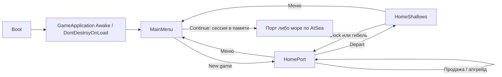

# Pipeline запуска и жизни игры

[Архитектура](architecture.md) · [Приложение](entities/application.md) · [Сессия](entities/session.md) · [Проверки](validation.md)

1. Build index 0 — Boot. Сериализованный GameApplication в Awake регистрирует Instance и сохраняет корневой объект. Пока нет новой игры, Session=null.
2. Start загружает MainMenu. Камеры MainMenu и HomePort дают URP отрисовать фон в standalone Player. MainMenu использует IMGUI, HomePort — Canvas с PortTradePanel. Каталог GameScenes содержит полные пути и проверяет наличие сцены до перехода.
3. New game загружает HomePort и создаёт новую SoloGameSession после завершения загрузки. Старое состояние заменяется только при успешной загрузке. Continue не создаёт новую сессию.
4. PortTradePanel передаёт продажу и покупку через HomePortController в сессию. Depart загружает HomeShallows с наполнением SecondCatchGraybox, затем устанавливает AtSea=true. В Awake HomeShallowsController привязывает лодку к существующему BoatState и применяет купленный SpeedMultiplier. Улов, урон и причал принимают команды после завершения загрузки.
5. PortZone расположен рядом с причалом и охватывает стартовую стоянку. После полного выхода корпуса повторный вход между тумбами загружает HomePort и вызывает Dock. HP, груз, монеты и апгрейд сохраняются.
6. SoloGameSession владеет BoatState с максимумом 60 HP. Рифы, скала и мусор передают контактный урон через BoatHealth. При гибели сессия один раз ставит 18 HP и AtSea=false, округляет оставшуюся половину груза вниз. HomeShallowsController останавливает лодку и запрашивает один переход в HomePort. Если сцена недоступна, постоянный корень показывает ошибку и Retry menu.
7. OpenMenu не завершает рейс и не продаёт груз. Continue выбирает море или порт по AtSea. New game начинает заново. Выход из приложения теряет всё состояние — дискового сохранения пока нет.

Во время перехода IsLoading=true, повторный переход отклоняется. UI, улов, урон и физический адаптер приостанавливают команды. При недоступной сцене состояние не меняется, Error показывается на постоянном корне, Retry menu возвращает к меню. При исключении запуска загрузки блокировка снимается. На одновременные операции рассчитан только главный поток Unity.

При прямом Play из MainMenu/HomePort/HomeShallows кнопка Open Boot открывает точку входа. Boot при повторной загрузке удаляет дубликат корня и оставляет текущую сессию. SecondCatchGraybox остаётся автономной сценой для настройки моря и лодки.

## Точка подключения улова

В `HomeShallows` экземпляры `FishSchool.prefab` привязаны к `HomeShallowsController` и `NetStation`. При контакте с коллайдером движущегося корпуса косяк передаёт порцию в опущенную сеть в пределах её вместимости. Подъём переносит улов на палубу, где `DeckCatch` создаёт экземпляры `FishOnDeck`. Каждый успешный клик по рыбе увеличивает груз бочки на одну единицу. `CargoHold` и `GameplayHud` читают бочку из той же сессии. Состояние косяков, рыба в сети и на палубе сохраняются при продолжении рейса из меню. [Настройка косяков, сети и бочки](entities/cargo.md)

## Решения S0

[Вики](https://wiki.yandex.ru/raid3/gdd-vtorojj-ulov-second-catch/vertikalnyjj-srez/2-mexanik-list/2.1-tz-dev/) описывает отдельный экран GameOver с кнопкой возврата и периодическую смену ветра. Для S0 по [#9](https://github.com/RelaxerR/raid-s3-jamstorm/issues/9) гибель сразу загружает порт с тем же штрафом. В S0 ветер вдоль +Z оставался постоянным. В S1 это стартовое направление, действуют [таймеры ветра](../boat-wind-movement.md#типы-и-случайная-смена-ветра). Автономный SecondCatchGraybox сохраняет случайный ветер и локальный респавн на 100 HP.

## Автоматическое покрытие

Сохранены ScenePipelineTests, SoloGameSessionTests и StationAssignmentTests. ScenePipelineTests проходит Boot → MainMenu → HomePort → HomeShallows, продолжение через меню и причаливание по физическому триггеру. Проверяет доступность руля, парусный ход, дрейф, контактный урон, сохранение HP, тягу после покупки, штраф за гибель с полной бочкой и единственный переход. Повторная загрузка Boot проверяет единственность приложения.

SoloGameSessionTests проверяет BoatState, FishCargo, сохранение HP, груза, монет и усиления между рейсами, новую сессию и Revision. Сохранение здесь означает состояние в памяти GameApplication между загрузками сцен. StationAssignmentTests проверяет назначения и освобождение. BoatRespawnControllerTests проверяет освобождение реальной станции при возврате graybox. Проверяется отсутствие Photon и кооперативного хоста в зависимостях одиночного pipeline. [Полный список и результат](validation.md)
