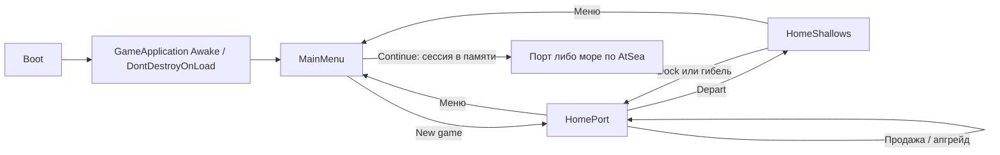

# Pipeline запуска и жизни игры

[Архитектура](architecture.md) · [Приложение](entities/application.md) · [Сессия](entities/session.md) · [Проверки](validation.md)

1. Build index 0 — Boot. Сериализованный GameApplication в Awake регистрирует Instance и сохраняет корневой объект. Пока нет новой игры, Session=null.
2. Start загружает MainMenu. Сервисов сети и сохранений нет. Каталог GameScenes содержит полные пути; отсутствие сцены проверяется до перехода.
3. New game загружает HomePort и создаёт новую SoloGameSession после завершения загрузки. Старое состояние заменяется только при успешной загрузке. Continue не создаёт новую сессию.
4. HomePortController продаёт рыбу и покупает улучшение через модель. Depart загружает HomeShallows, затем устанавливает AtSea=true. Новая геометрия и компоненты должны читать сессию после завершения IsLoading, а не в Awake/OnEnable.
5. Морской контроллер принимает сигналы проверенного источника улова, препятствий и причала. Обычный возврат загружает HomePort и вызывает Dock; груз, HP, монеты и апгрейд сохраняются.
6. При HP=0 модель сразу применяет однократную потерю 50% груза, HP=30%, AtSea=false. Контроллер запрашивает HomePort. Если переход не состоялся, состояние гибели сохраняется и контроллер повторяет переход. Повторный урон в порту ничего не меняет.
7. OpenMenu не завершает рейс и не продаёт груз. Continue выбирает море или порт по AtSea. New game начинает заново. Выход из приложения теряет всё состояние — дискового сохранения пока нет.

Во время перехода IsLoading=true, повторный переход отклоняется. UI, улов, урон и физический адаптер приостанавливают команды. При недоступной сцене состояние не меняется, Error показывается на постоянном корне, Retry menu возвращает к меню. При исключении запуска загрузки блокировка снимается. На одновременные операции рассчитан только главный поток Unity.

При прямом Play из MainMenu/HomePort/HomeShallows показывается Open Boot. SampleScene автономна и не поднимает приложение. Запуск с отключённой перезагрузкой сцены Unity пока не является поддерживаемым режимом проверки.
