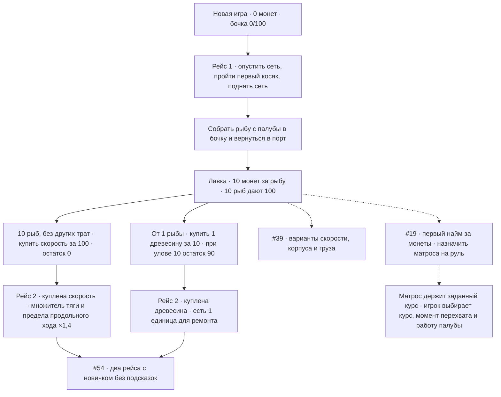

# S1. Прогрессия первых двух рейсов

Схема для обсуждения по [#55](https://github.com/RelaxerR/raid-s3-jamstorm/issues/55). Срез на 25 ноября 2026 года. Тег [v0.1.1](https://github.com/RelaxerR/raid-s3-jamstorm/releases/tag/v0.1.1) и проверенная ревизия ветки `relaxerr/s1-integration` указывают на `7c0eaa4c5199afa605a42d60e2275184ea790bb5`.

Пунктиром показаны задачи реализации. Подтверждённого места найма в последовательности покупок пока нет. После продажи десяти рыб можно также сохранить деньги и выйти повторно.

## Что проверяется в 0.1.1

| Шаг | Факт и способ проверки |
| --- | --- |
| Старт | Boot → «Новая игра» → HomePort. Баланс 0, древесина 0, бочка 0/100. Продажа и покупка недоступны. |
| Рейс 1 | HomeShallows. Первый косяк даёт 10 рыб в опущенную сеть, два других дают по 45. Нужно поднять сеть и в режиме ходьбы перенести каждую рыбу в бочку кликом. Для контрольного сценария поднять сеть сразу после улова. При движении возможны потери из сети, при причаливании рыба в сети и на палубе сбрасывается, при гибели часть груза теряется. |
| Продажа | После причаливания «Продать рыбу» и «Продать всё» при текущей одной бочке продают её содержимое целиком. При 10/100 и начальном балансе 0 выручка 100, баланс 100, бочка 0/100. При 9 рыбах выручка 90, улучшение ещё недоступно. |
| Первая покупка | Скорость открывается в лавке сразу после продажи, поднявшей баланс до 100. Покупка списывает 100, оставляет 0 и показывает «Куплено». Повтор запрещён. Самая дешёвая покупка — древесина за 10, доступная после продажи одной рыбы. Если продать 10 рыб и первой купить древесину, баланс 90 и покупка скорости откладывается. Фактический выбор новичка и время покупки ожидаются из #54. |
| Рейс 2 | Купленное улучшение переносится через смену сцен. Для тех же условий парусная тяга растёт в 1,4 раза. Код также масштабирует греблю и предел продольного хода. Время маршрута зависит от ветра, курса, волн и управления. Уже выловленный косяк снова доступен после выхода. |

Источники в репозитории: [сцена моря](../../Assets/_Project/Scenes/HomeShallows.unity), [префаб первого косяка](../../Assets/_Project/Prefabs/Fish/FishSchool.prefab), [сессия](../../Assets/_Project/Scripts/Runtime/Game/SoloGameSession.cs), [панель лавки](../../Assets/_Project/Scripts/Runtime/UI/PortTradePanel.cs), [применение улучшения при выходе](../../Assets/_Project/Scripts/Runtime/Voyage/HomeShallowsController.cs), [физика лодки](../../Assets/_Project/Scripts/Runtime/Boat/BoatController.cs).

## Проверки сборки и Unity

- Для указанной ревизии [Release builds](https://github.com/RelaxerR/raid-s3-jamstorm/actions/runs/45412853656) собрал архивы для macOS и Windows, прошёл шаг запуска Windows Player и опубликовал релиз. У скачанного macOS-архива совпал SHA-256 `41bfe04dfd522b13ba640ff9ffca9ccd49ee5de7368a29e2f88b3333ace6e658`, в `Info.plist` версия 0.1.1. В режиме `-batchmode -nographics` журнал macOS Player дошёл до инициализации Unity и загрузки ресурсов, затем содержал ошибки TLS. Графический запуск и прохождение рейсов в архиве ещё требуют ручного прогона.
- Из `Contents/Resources/Data/Managed/Runtime.dll` macOS-архива вызвали `SoloGameSession` через .NET. В каждой новой сессии вызвали `Depart`, `TakeSchoolIntoNet(1, 10, 100)`, `LandNetCatch`, затем `StoreDeckFish` для нужного числа рыб, `Dock`, `SellFish`, попытку покупки и повторный `Depart`. Это проверка релизной игровой логики без движка. Фиксированные 10 рыб на входе взяты из сцены.

| Рыб в бочке | Выручка | Покупка перед вторым выходом | Остаток | Множитель на втором выходе |
| --- | --- | --- | --- | --- |
| 1/100 | 10 | Древесина за 10, скорость недоступна | 0 | ×1,0 |
| 9/100 | 90 | Скорость недоступна | 90 | ×1,0 |
| 10/100 | 100 | Скорость за 100, повторная покупка отклонена | 0 | ×1,4 |
| 10/100 | 100 | Древесина за 10, затем скорость недоступна | 90 | ×1,0 |

В XML-отчётах [Unity CI для #53](https://github.com/RelaxerR/raid-s3-jamstorm/actions/runs/45412770909) прошли 72 теста EditMode и 13 PlayMode. Дерево Git проверенной ревизии PR `91bd96b` совпадает с деревом тега `v0.1.1`.

- [`PortTradePanelTests`](../../Assets/_Project/Scripts/Tests/PlayMode/PortTradePanelTests.cs) проверяет два выхода, оба действия продажи, покупку и сохранение апгрейда. Сценарий перемещает лодку к косяку и вызывает перенос рыбы в бочку программно.
- [`ScenePipelineTests`](../../Assets/_Project/Scripts/Tests/ScenePipelineTests.cs) проверяет измеряемый эффект на втором выходе. Парусная тяга, нормированная на степень подъёма паруса, равна исходной ×1,4 с допуском 0,05. Это замер свойства лодки в Unity. Время прохождения маршрута ещё предстоит измерить.
- [`FishSchoolTests`](../../Assets/_Project/Scripts/Tests/PlayMode/FishSchoolTests.cs) проверяет сеть и подбор кликом на движущейся лодке. [`WoodRepairVoyageTests`](../../Assets/_Project/Scripts/Tests/PlayMode/WoodRepairVoyageTests.cs) проверяет покупку древесины, её перенос в море и расход одной единицы на ремонт.

## Зависимости и границы показа

| Задача | Что уже доступно и что ещё предстоит |
| --- | --- |
| [#19](https://github.com/RelaxerR/raid-s3-jamstorm/issues/19) | Есть модель эксклюзивного назначения `StationAssignment` и ручной руль. Найм за монеты, цена, портовый UI и автоматическое удержание курса на этой ревизии отсутствуют. Для проверки после реализации поставить одинаковую задачу до и после найма: задать курс и собрать улов или отремонтировать корпус. Матрос ведёт по последнему заданному курсу при свободном руле. Игрок выбирает курс, вручную перехватывает руль и решает, когда покинуть его ради сети или ремонта. Проверить возврат автоматизации и сохранение назначения между портом и морем. |
| [#39](https://github.com/RelaxerR/raid-s3-jamstorm/issues/39) | Одно улучшение скорости уже работает. Корпус и груз как ветки улучшений, выбор между ветками и их цены остаются в #39. Для показа к 29 ноября замерить один сопоставимый отрезок до и после покупки. Сохранить лодку, курс, точку старта и финиша, начальную скорость, ветер и положение паруса. Записать время или скорость на отметке, условия прогона и причину покупки со слов игрока для [#57](https://github.com/RelaxerR/raid-s3-jamstorm/issues/57). |
| [#54](https://github.com/RelaxerR/raid-s3-jamstorm/issues/54) | Контрольные числа для сравнения есть. Требуется новый игрок или эксперт и 10–15 минут в опубликованной сборке без подсказок команды. Зафиксировать первую трудность на подборе рыбы, заметность подсказки, фактическую покупку и смысл второго выхода со слов игрока. |

## Вопросы для рабочей темы

К публикации приложить ссылку на схему и указать версию билда.

**Денис Трак.** Первый косяк при полном сборе даёт 100 монет, ровно на скорость. Одна потерянная рыба или покупка древесины оставляет 90. Должна ли первая продажа гарантировать доступ к улучшению при обычном прохождении? Если нужен выбор между ремонтом и скоростью, какой остаток и сколько действий или минут до первого апгрейда стоит считать целевыми?

**Аким Денисов.** Матрос держит последний курс, пока игрок работает у сети или ремонтирует корпус. Какое решение игрок должен принять после назначения, чтобы найм был заметен во втором рейсе? Достаточно ли выбора «оставить курс и поднять сеть сейчас / перехватить руль и сначала обойти препятствие»? Какое действие подтвердит, что игрок понял эту возможность без подсказки?

**Фактический статус на 25 ноября.** Схема и вопросы подготовлены. Публикация в рабочей теме, отправка запросов и ответы экспертов в рамках этой работы отсутствуют. Согласование не получено. Для его завершения нужны публикация командой и ответы Дениса и Акима. Для внешнего прогона нужен участник #54. После получения зафиксировать дату, ссылку на сообщение и решение или открытый вопрос.

## Протокол ручного прогона

| Что записать | Результат |
| --- | --- |
| Версия архива, платформа, дата и анонимный ID прогона | — |
| Время от «Новой игры» до первого улова в сети, первой рыбы в бочке, продажи и покупки | — |
| Улов в сети, в бочке на причале, баланс до и после продажи, покупка, цена и остаток | — |
| Где игрок замешкался или захотел прервать действие, видимость подсказки при крене и у руля | — |
| Тот же отрезок до и после покупки, условия, время или скорость | — |
| Что изменилось и зачем снова выходить в море, своими словами игрока | — |
| Один эпизод на исправление и повторную проверку | — |

Дефисы обозначают поля для заполнения по фактическому прогону. Контрольный маршрут и расчёт денег используются наблюдателем после записи самостоятельного выбора игрока.

Основания из [#55](https://github.com/RelaxerR/raid-s3-jamstorm/issues/55): «Новости RAID» от 18 ноября, №14608, Jamstorm от 21 ноября, №15578, уточнение срока №15571.
