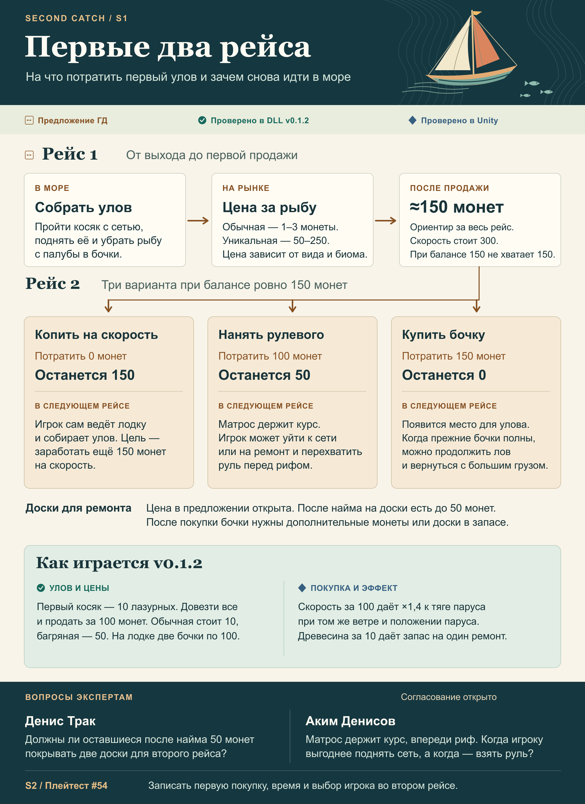
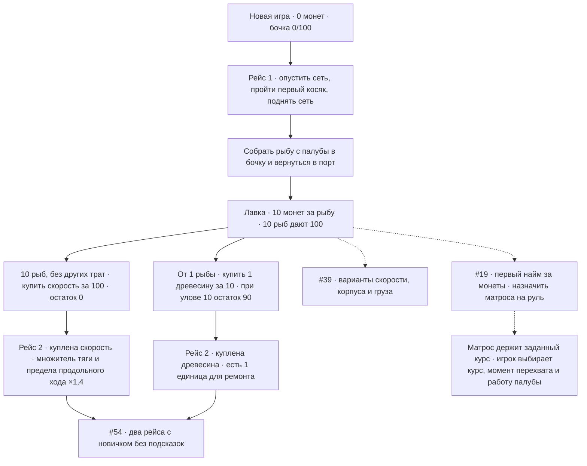

# S1. Прогрессия первых двух рейсов

ГД xzxslava предложил ориентир первой продажи — около 150 монет. При таком доходе можно начать копить на скорость, нанять рулевого или взять дополнительную бочку. На схеме показано, что игрок сможет сделать в следующем рейсе при каждом выборе. Ниже для сравнения приведены проверенные числа v0.1.2. [Комментарий ГД от 26 ноября](https://github.com/RelaxerR/raid-s3-jamstorm/pull/68#issuecomment-7190203458) · [Задача #55](https://github.com/RelaxerR/raid-s3-jamstorm/issues/55)

[Открыть PNG в полном размере](s1-two-voyage-progression.png) · [Исходник SVG с текстовыми подписями](s1-two-voyage-progression.svg)

## Предложение ГД от 26 ноября

Обычная рыба стоит 1–3 монеты за штуку, уникальная — 50–250 в зависимости от вида и биома. Около 150 монет — ориентир выручки за **весь первый рейс**. Состав улова в предложении не задан. Для сравнения, десять обычных рыб при таких ценах дадут от 10 до 30 монет. [Исходный комментарий](https://github.com/RelaxerR/raid-s3-jamstorm/pull/68#issuecomment-7190203458)

| Решение в порту при балансе ровно 150 | Остаток до покупки досок | Что меняется в рейсе 2 |
| --- | ---: | --- |
| Сохранить деньги на скорость за 300 | 150 монет | Игрок сам ведёт лодку и работает у сети. До покупки скорости нужно заработать ещё 150. |
| Нанять рулевого за 100 | 50 монет | Игрок задаёт курс и уходит к сети или на ремонт. Матрос держит курс до ручного перехвата. Перед рифом игрок решает, продолжать работу или взять руль. |
| Купить дополнительную бочку за 150 | 0 монет | Если прежние бочки полны, можно продолжить лов и доставить больше рыбы. Ёмкость новой бочки ГД пока не указал. |

ГД также предложил взять в рейс пару досок. После найма на них остаётся 50 монет, стоимость пары ещё нужно уточнить. Если бочка забрала все 150, на доски потребуется дополнительная выручка или запас до покупки. Фактическая первая покупка и её время станут известны после самостоятельного прогона в S2. [Плейтест #54](https://github.com/RelaxerR/raid-s3-jamstorm/issues/54)

## Проверка рулевого в S2

В лавке игрок нанимает Ивана за 100 монет и отдельно назначает его на руль. В сравнительном тесте лодка под полным парусом начинала в 40 единицах к востоку от центра острова. Игрок поворачивал вправо одну секунду и оставлял руль. Через восемь секунд свободную лодку увело волной на 11,69° влево. С Иваном отклонение от заданного курса составило 0,19°. После ручного перехвата Иван удержал новый курс. Матрос управляет углом руля. Парус, боковой снос и выбор пути мимо рифов остаются частью задачи игрока. [Сравнительный тест EditMode](../../Assets/_Project/Scripts/Tests/HelmStationTests.cs) · [Сценарий показа на палубе](entities/stations-crew.md)

В контрольном macOS-плеере лодка под полным парусом шла на север в 40 единицах к востоку от центра. Игрок оставил прямой руль и перешёл к сети. Через восемь секунд компас показал 319° без матроса и 000° с Иваном. Начальные условия выставлял проверочный сценарий. [Свободный руль](../evidence/s2-helm/free-8s.jpg) · [Рулевой на станции](../evidence/s2-helm/crew-8s.jpg) · [Найм в порту](../evidence/s2-helm/port-offer.jpg) · [Подсказка при ручном перехвате, 1000×620](../evidence/s2-helm/helm-1000x620.jpg)

## Сколько приносит первый косяк в v0.1.2

На старте у игрока 0 монет. В HomeShallows первый косяк по курсу от причала даёт 10 лазурных рыб в опущенную сеть. Для контрольного рейса поднимите сеть, в режиме ходьбы кликните по каждой рыбе на палубе и проверьте бочку до швартовки. Продать можно только доставленный груз. Рыба может уйти из сети на ходу или упасть с палубы, а при швартовке незапасённый улов пропадает. [Сцена](../../Assets/_Project/Scenes/HomeShallows.unity) · [Порция первого косяка](../../Assets/_Project/Prefabs/Fish/FishSchool.prefab) · [Правила улова](entities/cargo.md)

| Довезли из первых 10 | Выручка | Первая покупка в порту | Что игрок берёт в рейс 2 |
| --- | ---: | --- | --- |
| 1 лазурную | 10 монет | 1 древесина за 10 | 0 монет, запас на один ремонт |
| 9 лазурных | 90 монет | До скорости не хватает 10 | Без покупки сохраняются 90 монет и базовая тяга |
| 10 лазурных | 100 монет | Скорость за 100 сразу после продажи | 0 монет, множитель тяги ×1,4 |
| 10 лазурных | 100 монет | Сначала 1 древесина за 10 | 90 монет, базовая тяга, запас на один ремонт |

В этой версии у лодки две бочки по 100. Первая рыба определяет вид пустой бочки. Лазурная и янтарная идут в разные бочки и стоят по 10 монет за штуку. Багряную с гарпуна хранят в отдельном слоте и продают за 50. На рынке можно продать весь запас выбранного вида или весь груз. Для порога первой покупки выше учтён только обычный улов. [Модель груза](../../Assets/_Project/Scripts/Runtime/Game/FishCargo.cs) · [Расчёт цены и списание](../../Assets/_Project/Scripts/Runtime/Game/SoloGameSession.cs) · [Кнопки лавки](../../Assets/_Project/Scripts/Runtime/UI/PortTradePanel.cs)

## Что проверено в v0.1.2

**Опубликованная сборка.** Для macOS-архива из релиза сверены версия Player 0.1.2 и SHA-256 `a192cf851161811c629f69032ff4c18a96efde4f95d187107761afd0445c99a8`. В .NET вызваны методы игровой сессии непосредственно из `Contents/Resources/Data/Managed/Runtime.dll`. В каждой новой сессии выполнены выход, приём порции из 10 лазурных в сеть, подъём сети, перенос 1, 9 или 10 рыб в бочку, швартовка, продажа, попытка покупки и повторный выход. Входная порция взята из префаба и сцены. Все четыре строки таблицы воспроизвелись. Повторная покупка скорости отклонена. На втором выходе с древесиной ремонт повреждённой зоны израсходовал одну единицу запаса. Смешанный груз из одной лазурной, одной янтарной и одной багряной дал 70 монет как при общей, так и при последовательной продаже. Это проверка логики релизного архива без графического прохождения. [Архив и контрольная сумма](https://github.com/RelaxerR/raid-s3-jamstorm/releases/tag/v0.1.2)

**Сцена и тесты Unity.** Дерево проверки интеграционного PR #67 совпадает с деревом тега `v0.1.2` (`fd60ea4`). Отчёты CI содержат 80 прошедших тестов EditMode и 22 PlayMode. На втором выходе тест `BootMenuPortSeaReturnAndRestart` поднимает парус и сравнивает продольную парусную тягу, делённую на степень подъёма паруса, с результатом первого выхода. Измеренное значение укладывается в исходное ×1,4 с допуском 0,05. Отдельные тесты проходят продажу и покупку через панель порта и расход древесины при ремонте с палубы. [Отчёты Unity CI](https://github.com/RelaxerR/raid-s3-jamstorm/actions/runs/45687293770) · [Сравнение тяги](../../Assets/_Project/Scripts/Tests/ScenePipelineTests.cs) · [Лавка](../../Assets/_Project/Scripts/Tests/PlayMode/PortTradePanelTests.cs) · [Ремонт](../../Assets/_Project/Scripts/Tests/PlayMode/WoodRepairVoyageTests.cs)

**Проверка с игроком.** Для показа к 29 ноября пройти один участок до и после покупки с одной лодкой, теми же отметками, начальной скоростью, курсом, ветром и положением паруса. Снять время пути или скорость у отметки. В S2 в рамках #54 дать новичку два рейса без подсказок и записать время первой покупки, реальный выбор и объяснение, зачем снова выходить в море. Замера секунд и ответа игрока для v0.1.2 пока нет. Корпус и вместимость как варианты покупки остаются в #39. [Улучшения #39](https://github.com/RelaxerR/raid-s3-jamstorm/issues/39) · [Внешний прогон #54](https://github.com/RelaxerR/raid-s3-jamstorm/issues/54) · [Форма наблюдений](s1-two-voyage-playtest.md)

**Первый найм.** В #19 игрок нанимает матроса в порту и назначает его на руль. Матрос держит последний заданный курс, пока игрок работает у сети или ремонтирует корпус. Игрок выбирает курс и момент, когда вернуться к рулю. После реализации проверить один эпизод с рифом и готовой к подъёму сетью до и после назначения. Ручной перехват должен менять курс, уход игрока со станции — возвращать управление матросу. Для обсуждения ГД предложил цену 100 монет. В v0.1.2 портовый найм ещё не реализован. [Требования к найму #19](https://github.com/RelaxerR/raid-s3-jamstorm/issues/19)

## На чём основаны вопросы

В локальной выгрузке MyIndie RAID сверены исходные сообщения, перечисленные в #55. Ссылки на сообщения открываются у участников чата.

| Откуда требование | Что оно означает для показа |
| --- | --- |
| Влад Борец, «Новости RAID», 18 ноября | В начале второй недели представить схему экспертам, к концу показать в билде, как результат одного цикла меняет следующий. [№14608](https://t.me/c/3808579536/14608) |
| Влад Борец, Jamstorm, 21 ноября | Этапы считают от 16 ноября. В ранней версии повтор выходов, лавки и подъёма паруса утомлял. Для нового прогона важно услышать, зачем игрок сам отправился во второй рейс. [№15570–15571](https://t.me/c/3808579536/15571) · [№15577](https://t.me/c/3808579536/15577) |
| John Karter, Jamstorm, 21 ноября | Команда предложила прогрессию через улучшение станций и назначение экипажа. Роль первого матроса конкретизирована в #19. [№15578](https://t.me/c/3808579536/15578) · [#19](https://github.com/RelaxerR/raid-s3-jamstorm/issues/19) |

Предложение ГД по ценам учтено в схеме. Два адресных вопроса поставлены в [#55](https://github.com/RelaxerR/raid-s3-jamstorm/issues/55). Согласование открыто. После публикации в рабочем топике команда сможет добавить дату, ссылку на ответ и принятое решение по каждому вопросу. Предыдущая версия схемы подготовлена в [PR #63](https://github.com/RelaxerR/raid-s3-jamstorm/pull/63).

## Текст для рабочего топика

> Обновили схему по предложению ГД. Если после первого рейса получили 150 монет, на скорость за 300 нужно заработать ещё столько же. Можно нанять рулевого за 100 и оставить 50 на доски. Можно взять бочку за 150, тогда доски нужны из запаса. Для сравнения на схеме есть цены действующей сборки. [Схема](https://raw.githubusercontent.com/RelaxerR/raid-s3-jamstorm/relaxerr/s1-progression-visual/docs/v2/s1-two-voyage-progression.png) · [Билд v0.1.2](https://github.com/RelaxerR/raid-s3-jamstorm/releases/tag/v0.1.2)
>
> Денис Трак, должны ли оставшиеся после найма 50 монет покрывать две доски для второго рейса?
>
> Аким Денисов, матрос держит курс, впереди риф. Когда игроку выгоднее поднять сеть, а когда взять руль? В S2 проверим, как это решение принимает новый игрок.

Исторический срез v0.1.1 и протокол из PR #63

Схема для обсуждения по [#55](https://github.com/RelaxerR/raid-s3-jamstorm/issues/55). Срез на 25 ноября 2026 года. Тег [v0.1.1](https://github.com/RelaxerR/raid-s3-jamstorm/releases/tag/v0.1.1) и проверенная ревизия ветки `relaxerr/s1-integration` указывают на `7c0eaa4c5199afa605a42d60e2275184ea790bb5`.

Пунктиром показаны задачи реализации. Подтверждённого места найма в последовательности покупок пока нет. После продажи десяти рыб можно также сохранить деньги и выйти повторно.

## Что проверяется в 0.1.1

| Шаг | Факт и способ проверки |
| --- | --- |
| Старт | Boot → «Новая игра» → HomePort. Баланс 0, древесина 0, бочка 0/100. Продажа и покупка недоступны. |
| Рейс 1 | HomeShallows. Первый косяк даёт 10 рыб в опущенную сеть, два других дают по 45. Нужно поднять сеть и в режиме ходьбы перенести каждую рыбу в бочку кликом. Для контрольного сценария поднять сеть сразу после улова. При движении возможны потери из сети, при причаливании рыба в сети и на палубе сбрасывается, при гибели часть груза теряется. |
| Продажа | После причаливания «Продать рыбу» и «Продать всё» при текущей одной бочке продают её содержимое целиком. При 10/100 и начальном балансе 0 выручка 100, баланс 100, бочка 0/100. При 9 рыбах выручка 90, улучшение ещё недоступно. |
| Первая покупка | Скорость открывается в лавке сразу после продажи, поднявшей баланс до 100. Покупка списывает 100, оставляет 0 и показывает «Куплено». Повтор запрещён. Самая дешёвая покупка — древесина за 10, доступная после продажи одной рыбы. Если продать 10 рыб и первой купить древесину, баланс 90 и покупка скорости откладывается. Фактический выбор новичка и время покупки ожидаются из #54. |
| Рейс 2 | Купленное улучшение переносится через смену сцен. Для тех же условий парусная тяга растёт в 1,4 раза. Код также масштабирует греблю и предел продольного хода. Время маршрута зависит от ветра, курса, волн и управления. Уже выловленный косяк снова доступен после выхода. |

Источники в репозитории: [сцена моря](../../Assets/_Project/Scenes/HomeShallows.unity), [префаб первого косяка](../../Assets/_Project/Prefabs/Fish/FishSchool.prefab), [сессия](../../Assets/_Project/Scripts/Runtime/Game/SoloGameSession.cs), [панель лавки](../../Assets/_Project/Scripts/Runtime/UI/PortTradePanel.cs), [применение улучшения при выходе](../../Assets/_Project/Scripts/Runtime/Voyage/HomeShallowsController.cs), [физика лодки](../../Assets/_Project/Scripts/Runtime/Boat/BoatController.cs).

## Проверки сборки и Unity

- Для указанной ревизии [Release builds](https://github.com/RelaxerR/raid-s3-jamstorm/actions/runs/45412853656) собрал архивы для macOS и Windows, прошёл шаг запуска Windows Player и опубликовал релиз. У скачанного macOS-архива совпал SHA-256 `41bfe04dfd522b13ba640ff9ffca9ccd49ee5de7368a29e2f88b3333ace6e658`, в `Info.plist` версия 0.1.1. В режиме `-batchmode -nographics` журнал macOS Player дошёл до инициализации Unity и загрузки ресурсов, затем содержал ошибки TLS. Графический запуск и прохождение рейсов в архиве ещё требуют ручного прогона.
- Из `Contents/Resources/Data/Managed/Runtime.dll` macOS-архива вызвали `SoloGameSession` через .NET. В каждой новой сессии вызвали `Depart`, `TakeSchoolIntoNet(1, 10, 100)`, `LandNetCatch`, затем `StoreDeckFish` для нужного числа рыб, `Dock`, `SellFish`, попытку покупки и повторный `Depart`. Это проверка релизной игровой логики без движка. Фиксированные 10 рыб на входе взяты из сцены.

| Рыб в бочке | Выручка | Покупка перед вторым выходом | Остаток | Множитель на втором выходе |
| --- | --- | --- | --- | --- |
| 1/100 | 10 | Древесина за 10, скорость недоступна | 0 | ×1,0 |
| 9/100 | 90 | Скорость недоступна | 90 | ×1,0 |
| 10/100 | 100 | Скорость за 100, повторная покупка отклонена | 0 | ×1,4 |
| 10/100 | 100 | Древесина за 10, затем скорость недоступна | 90 | ×1,0 |

В XML-отчётах [Unity CI для #53](https://github.com/RelaxerR/raid-s3-jamstorm/actions/runs/45412770909) прошли 72 теста EditMode и 13 PlayMode. Дерево Git проверенной ревизии PR `91bd96b` совпадает с деревом тега `v0.1.1`.

- [`PortTradePanelTests`](../../Assets/_Project/Scripts/Tests/PlayMode/PortTradePanelTests.cs) проверяет два выхода, оба действия продажи, покупку и сохранение апгрейда. Сценарий перемещает лодку к косяку и вызывает перенос рыбы в бочку программно.
- [`ScenePipelineTests`](../../Assets/_Project/Scripts/Tests/ScenePipelineTests.cs) проверяет измеряемый эффект на втором выходе. Парусная тяга, нормированная на степень подъёма паруса, равна исходной ×1,4 с допуском 0,05. Это замер свойства лодки в Unity. Время прохождения маршрута ещё предстоит измерить.
- [`FishSchoolTests`](../../Assets/_Project/Scripts/Tests/PlayMode/FishSchoolTests.cs) проверяет сеть и подбор кликом на движущейся лодке. [`WoodRepairVoyageTests`](../../Assets/_Project/Scripts/Tests/PlayMode/WoodRepairVoyageTests.cs) проверяет покупку древесины, её перенос в море и расход одной единицы на ремонт.

## Зависимости и границы показа

| Задача | Что уже доступно и что ещё предстоит |
| --- | --- |
| [#19](https://github.com/RelaxerR/raid-s3-jamstorm/issues/19) | Есть модель эксклюзивного назначения `StationAssignment` и ручной руль. Найм за монеты, цена, портовый UI и автоматическое удержание курса на этой ревизии отсутствуют. Для проверки после реализации поставить одинаковую задачу до и после найма: задать курс и собрать улов или отремонтировать корпус. Матрос ведёт по последнему заданному курсу при свободном руле. Игрок выбирает курс, вручную перехватывает руль и решает, когда покинуть его ради сети или ремонта. Проверить возврат автоматизации и сохранение назначения между портом и морем. |
| [#39](https://github.com/RelaxerR/raid-s3-jamstorm/issues/39) | Одно улучшение скорости уже работает. Корпус и груз как ветки улучшений, выбор между ветками и их цены остаются в #39. Для показа к 29 ноября замерить один сопоставимый отрезок до и после покупки. Сохранить лодку, курс, точку старта и финиша, начальную скорость, ветер и положение паруса. Записать время или скорость на отметке, условия прогона и причину покупки со слов игрока для [#57](https://github.com/RelaxerR/raid-s3-jamstorm/issues/57). |
| [#54](https://github.com/RelaxerR/raid-s3-jamstorm/issues/54) | Контрольные числа для сравнения есть. Требуется новый игрок или эксперт и 10–15 минут в опубликованной сборке без подсказок команды. Зафиксировать первую трудность на подборе рыбы, заметность подсказки, фактическую покупку и смысл второго выхода со слов игрока. |

## Вопросы для рабочей темы

К публикации приложить ссылку на схему и указать версию билда.

**Денис Трак.** Первый косяк при полном сборе даёт 100 монет, ровно на скорость. Одна потерянная рыба или покупка древесины оставляет 90. Должна ли первая продажа гарантировать доступ к улучшению при обычном прохождении? Если нужен выбор между ремонтом и скоростью, какой остаток и сколько действий или минут до первого апгрейда стоит считать целевыми?

**Аким Денисов.** Матрос держит последний курс, пока игрок работает у сети или ремонтирует корпус. Какое решение игрок должен принять после назначения, чтобы найм был заметен во втором рейсе? Достаточно ли выбора «оставить курс и поднять сеть сейчас / перехватить руль и сначала обойти препятствие»? Какое действие подтвердит, что игрок понял эту возможность без подсказки?

**Фактический статус на 25 ноября.** Схема и вопросы подготовлены. Публикация в рабочей теме, отправка запросов и ответы экспертов в рамках этой работы отсутствуют. Согласование не получено. Для его завершения нужны публикация командой и ответы Дениса и Акима. Для внешнего прогона нужен участник #54. После получения зафиксировать дату, ссылку на сообщение и решение или открытый вопрос.

## Протокол ручного прогона

| Что записать | Результат |
| --- | --- |
| Версия архива, платформа, дата и анонимный ID прогона | — |
| Время от «Новой игры» до первого улова в сети, первой рыбы в бочке, продажи и покупки | — |
| Улов в сети, в бочке на причале, баланс до и после продажи, покупка, цена и остаток | — |
| Где игрок замешкался или захотел прервать действие, видимость подсказки при крене и у руля | — |
| Тот же отрезок до и после покупки, условия, время или скорость | — |
| Что изменилось и зачем снова выходить в море, своими словами игрока | — |
| Один эпизод на исправление и повторную проверку | — |

Дефисы обозначают поля для заполнения по фактическому прогону. Контрольный маршрут и расчёт денег используются наблюдателем после записи самостоятельного выбора игрока.

Основания из [#55](https://github.com/RelaxerR/raid-s3-jamstorm/issues/55): «Новости RAID» от 18 ноября, №14608, Jamstorm от 21 ноября, №15578, уточнение срока №15571.

